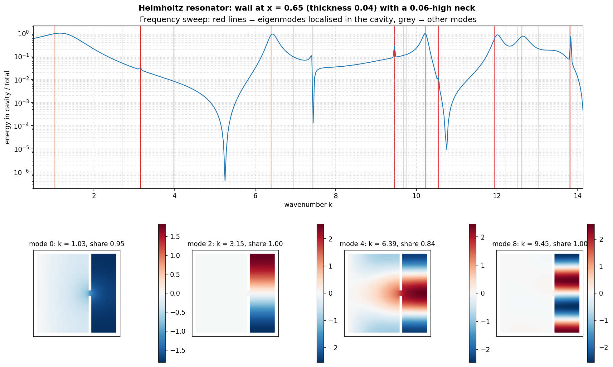
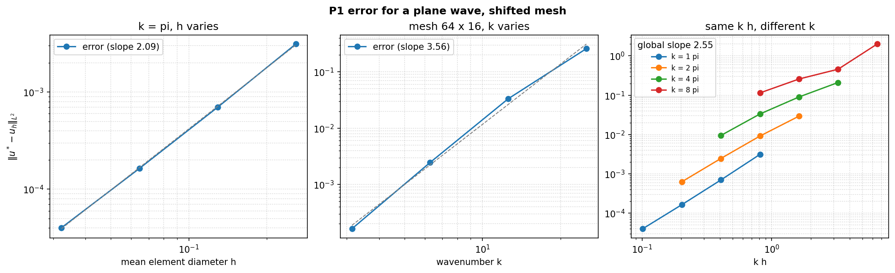
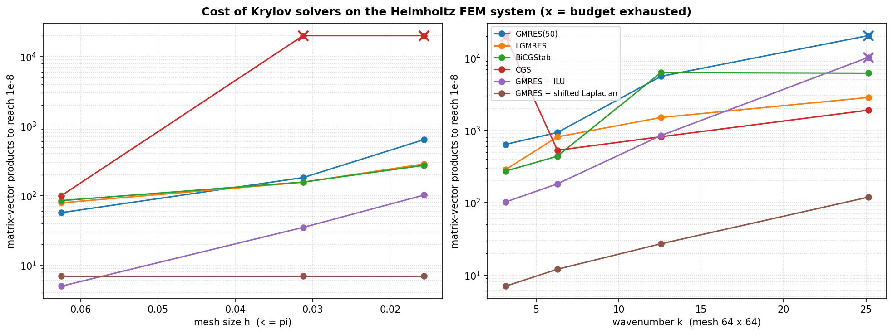
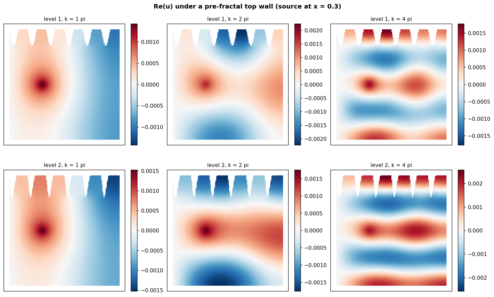
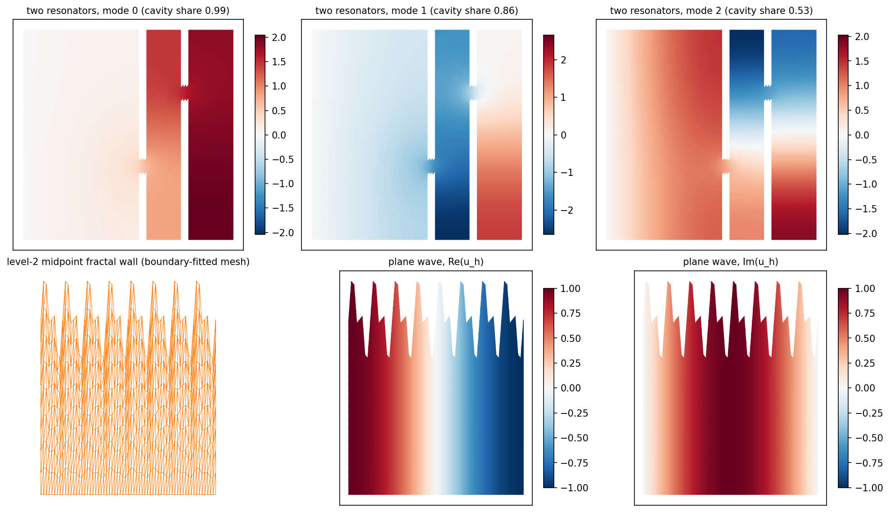
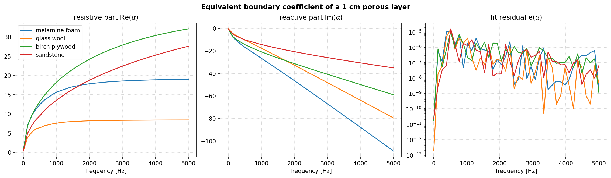

# Helmholtz FEM Acoustics

**Controlling noise with geometry and materials, simulated with finite elements written from scratch.**

This repository gathers four numerical studies on the 2D Helmholtz equation
`-Δu - k²u = f`, the frequency-domain model of acoustic waves. Everything is built on
`helmfem`, a small, fully vectorised P1 finite element library (under 500 lines, NumPy + SciPy only):
meshing, sparse assembly, boundary conditions, eigenvalue problems.



| Study | Question | Key result |
|---|---|---|
| [1. Pollution error](#1-discretisation-error-and-pollution) | How accurate are P1 elements as frequency grows? | `err ~ h^1.93` at fixed k, but `err ~ k^3.6` on a fixed mesh: the pollution effect |
| [2. Iterative solvers](#2-krylov-solvers-for-an-indefinite-system) | Which Krylov method for the indefinite Helmholtz matrix? | A shifted-Laplacian preconditioner cuts the cost from thousands of mat-vecs to 7–119, independently of the mesh |
| [3. Geometry and resonators](#3-pre-fractal-walls-and-helmholtz-resonators) | Can a wall shape trap sound? | Frequency sweep resonances line up with the eigenmodes localised in the cavity |
| [4. Porous materials](#4-equivalent-boundary-condition-for-porous-walls) | Can a porous layer be replaced by one boundary coefficient? | Fitted α(ω) for 4 materials, residual below 2·10⁻⁵ |

## Quick start

```bash
git clone https://github.com/bastiencetre/helmholtz-fem-acoustics.git
cd helmholtz-fem-acoustics
pip install -e .
pytest                                   # 12 tests, ~2 s
python studies/study1_pollution_error.py # each study writes its figures to figures/
```

All four studies run in about a minute on a laptop.

## The `helmfem` library

```
helmfem/
├── mesh.py       # structured, shifted and boundary-fitted meshes, carving geometries out of a square
├── assembly.py   # stiffness / mass matrices, Dirichlet elimination, L2 error
├── porous.py     # equivalent-fluid model of a porous wall and the α(ω) fit
└── plotting.py   # field plots and log-log convergence fits
```

```python
from helmfem import square_mesh, helmholtz_system, apply_dirichlet, square_boundary_nodes
from scipy.sparse.linalg import spsolve
import numpy as np

mesh = square_mesh(64, 64)
k = 4 * np.pi
A, b, K, M = helmholtz_system(mesh, k)                      # A = K - k² M (sparse, complex)
exact = np.exp(1j * k * mesh.nodes[:, 0])                     # plane wave
border = square_boundary_nodes(mesh)
A, b = apply_dirichlet(A, b, border, exact[border])
u = spsolve(A.tocsc(), b)
```

Element matrices are computed for all triangles at once with NumPy broadcasting and
scattered into a CSR matrix: a 100 000-node mesh assembles in about 0.25 s.
The tests check the library against exact properties: the mass matrix integrates constants
exactly, the stiffness matrix annihilates them, linear functions have the right energy, and the
plane-wave error converges at order 2.

## 1. Discretisation error and pollution

`studies/study1_pollution_error.py`. The exact solution `u* = exp(ikx)` is imposed on the
border of the unit square and compared with the finite element solution.



| Mesh | slope vs h (k = π) | slope vs k (64×16 mesh) | global slope vs kh |
|---|---|---|---|
| regular | 1.93 | 3.63 | 2.62 |
| every other row shifted by 0.3 h | 2.09 | 3.56 | 2.55 |

At fixed frequency the error decreases as `h²`, the optimal order for P1 elements in L2. On a
fixed mesh, however, it grows much faster than `k²`: the numerical wave travels at a slightly
wrong speed and the phase error accumulates over the domain. The right panel makes this visible:
for the same number of points per wavelength (same `kh`), the error is larger at high frequency.
Keeping `kh` constant is not enough, the mesh has to be refined faster than the frequency grows.
Shifting the mesh nodes does not change these orders when `h` is measured as the mean element
diameter.

## 2. Krylov solvers for an indefinite system

`studies/study2_iterative_solvers.py`. Once `k²` exceeds the first Laplace eigenvalue,
`A = K - k²M` is indefinite (and complex symmetric, not Hermitian), so conjugate gradient no
longer applies. Since SciPy counts "iterations" differently for each method, the comparison
counts **matrix-vector products** needed to reach a relative residual of 10⁻⁸.



| k (mesh 64×64) | GMRES(50) | LGMRES | BiCGStab | CGS | GMRES + ILU | GMRES + shifted Laplacian |
|---|---|---|---|---|---|---|
| π  | 640 | 286 | 273 | no conv. | 102 | **7** |
| 2π | 934 | 812 | 439 | 530 | 182 | **12** |
| 4π | 5 578 | 1 506 | 6 297 | 816 | 848 | **27** |
| 8π | no conv. | 2 848 | 6 178 | 1 900 | no conv. | **119** |

* Without preconditioning every method degrades quickly with frequency; restarted GMRES
  loses the most, CGS is erratic (it stagnates even at low frequency).
* An incomplete LU factorisation helps at low frequency but breaks down at `k = 8π`: ILU is
  known to be unreliable for strongly indefinite matrices.
* The shifted-Laplacian preconditioner `(K - (1 - 0.5i) k² M)⁻¹` (Erlangga, Vuik & Oosterlee, 2004)
  adds damping, which moves the spectrum away from zero. Its iteration count stays at 7 when the
  mesh is refined. It is applied exactly here (one sparse LU); in production it would be
  approximated by a multigrid cycle.

## 3. Pre-fractal walls and Helmholtz resonators

`studies/study3_geometry_resonators.py`. Geometries are carved out of a square mesh by
removing elements. The left side is a Dirichlet boundary (`u = 0`), every other wall is rigid
(Neumann), and a Gaussian source sits in the open region.

**Helmholtz resonator** (figure at the top): a wall with a single neck closes a cavity. The
generalised eigenproblem `Kφ = λMφ` is solved with shift-invert Lanczos (`eigsh`), and each mode
is scored by the share of its energy `φᴴ M_cavity φ / φᴴ M φ` stored in the cavity. A sweep over
400 frequencies shows that peaks of trapped energy occur at the eigenfrequencies `k = √λ` of the
localised modes (red lines). The lowest one (`k ≈ 1.03`) is the classic Helmholtz "breathing" mode
where air oscillates through the neck. Modes with a node at the neck are fully trapped but barely
excited by an external source.





The fractal wall uses a **boundary-fitted** mesh: a structured mesh is stretched column by column
so that every vertex of the fractal profile is a mesh node and the boundary has no geometric error.

## 4. Equivalent boundary condition for porous walls

`studies/study4_porous_absorption.py`. Simulating a porous layer requires a second medium
with its own dissipative wave equation. Instead, the layer can be replaced by a Robin condition
`μ₀ ∂u/∂n + α u = 0` on the wall. Decomposing both problems in Fourier modes along the wall
gives a closed-form error `e(α) = Σ_k e_k(α)` between the two air fields, minimised over
`α ∈ ℂ` for every frequency.



Fibrous materials (glass wool, melamine foam) have a resistive part that saturates early, while
resistive materials (sandstone, `σ = 10⁶ Pa·s/m²`) keep increasing with frequency. The residual stays
below 2·10⁻⁵ over the whole 0–5 kHz range, so a single complex coefficient per frequency is an
accurate substitute for the porous layer in a full-scale simulation.

## Context and what changed

These studies were coursework for the *Theoretical and Computational Acoustics* course
(F. Magoulès) at CentraleSupélec, 2025. The original reports, in French, are in [`reports/`](reports/).
The course's helper library was replaced by `helmfem`, written for this repository, and the
studies were revisited:

* **Fair solver comparison.** The original report counted LGMRES outer cycles but GMRES inner
  iterations, and let the solvers stop at SciPy's default tolerance (10⁻⁵ instead of 10⁻⁸), which
  made LGMRES look about 40 times cheaper than it is (7 "iterations" against 286 matrix-vector
  products at k = π). The solvers are now compared on the number
  of matrix-vector products, and the two preconditioners suggested as future work are implemented.
* **Leaky resonator wall.** The original wall was 0.02 thick on a mesh of size 1/56: removing
  elements by centroid left triangles connecting both sides, so the "cavity" was not closed and the
  reported localisation scores (≈ 0.63) were artefacts. The wall is now two cells thick, a
  regression test checks that a closed wall splits the mesh in two, and the localised modes reach a
  cavity energy share of 0.95–1.00.
* **Exact fractal boundary.** The Delaunay mesh of the fractal wall lost 4 % of the domain area
  because triangles cannot follow a concave boundary; it is replaced by a boundary-fitted mesh.
* Dense matrices and per-element Python loops were replaced by vectorised sparse assembly.
  Study 1 reproduces the original slopes to three digits.

## License

MIT, see [LICENSE](LICENSE).
